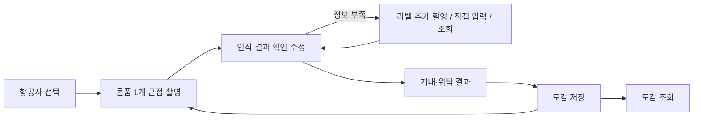

# 구현계획서 v4: 여행 짐 반입 확인 + 개인 도감 (백엔드 + 시연 체크 화면)

> 작업 도구: Codex / 배포: Netlify / MVP 기준: 항공사 1개, 시연용 규정 + Gemini(무료 키) 인식
> **역할 분리**: 디자인·사용자 프론트는 별도 팀. 이 문서의 범위는 **백엔드 API + 계약(contract) + 시연 체크 화면**.
> **v4 핵심 변경**: 짐 전체를 한 번에 찍는 방식이 아니라, **챙길 물품을 하나씩 근접 촬영해 담는 방식**. 필드별 출처 기록, 용량 계산, 제품 정보 조회(선택) 추가.
> **v5 핵심 변경**: 촬영 모드 2종 — **라벨 모드**(가이드 프레임에 제품 정보를 맞춰 촬영, 크롭 후 전송)와 **추정 모드**(제품 정보가 없거나 읽기 어려울 때 근접샷으로 AI가 종류를 추정). 추정 결과를 단정하지 않는 안전장치(P10~P11) 추가.

---

## 1. 역할과 범위

| 영역 | 담당 | 이 문서에서 |
|---|---|---|
| 백엔드 API (인식 프록시, 판정 엔진, 규정 데이터) | 나 | **구현** |
| 계약(contract): 타입·스키마·OpenAPI·픽스처·한국어 문구 | 나 | **구현 (프론트 기준)** |
| 시연 체크 화면 (내부 검증용, 디자인 최소) | 나 | **구현** |
| 사용자용 프론트 (디자인, 촬영/도감 UX) | 프론트 담당 | 구현하지 않음, 연동 가이드만 제공 |

### 1.1 서비스 정의
여행자가 챙길 물품을 **하나씩 근접 촬영**해서 담으면, AI가 물품과 제품 정보(모델명, 용량 등)를 읽고, 선택한 항공사 기준으로 기내 휴대·위탁 가능 여부를 보여준다. 확인한 물품은 사진·제품 정보와 함께 개인 도감에 저장해, 직원이 물을 때 보여줄 **참고 화면**으로 쓴다.

### 1.2 핵심 원칙
| # | 원칙 |
|---|------|
| P1 | **인식(AI)과 판정(규정)을 분리**한다 |
| P2 | 인식 결과는 사용자가 확인·수정할 수 있다 (수정값으로 재판정) |
| P3 | 읽을 수 없는 제품 정보는 **만들어내지 않고** `null` + `unreadFields`로 반환한다 |
| P4 | 실제 AI·최신 규정이 없으면 응답에 `isDemo`를 명시하고, Provider는 교체 가능하게 둔다 |
| P5 | API가 만드는 문구(reason, staffSummary)에 **보안검색 통과·반입 허가를 보장하는 표현을 쓰지 않는다** |
| P6 | 규정 수치는 추측하지 않는다. 시연용은 `isDemo: true` |
| P7 | **계약 우선**: 엔드포인트 구현 전 contract 확정, 변경은 버전과 함께 기록 |
| P8 | 우리 서버는 **사진을 저장하지 않는다**, 로그에 이미지·개인정보 금지. (Gemini 무료 키 사용 시 입력이 Google에서 제품 개선에 쓰일 수 있음을 체크 화면에 고지) |
| P9 | **필드마다 출처를 기록**한다: `label`(라벨 판독) / `user`(사용자 입력) / `calculated`(계산) / `lookup`(조회). 조회값은 사용자 확인 전 확정값으로 쓰지 않는다 |
| P10 | **AI 추정 결과는 단정하지 않는다**: 추정 모드 결과는 `ai_estimated`로 표시하고, 사용자 확인 전에는 확정 표현을 쓰지 않으며, 위험 카테고리는 추정만으로 "가능"을 확정하지 않는다 |
| P11 | **외형으로 수치를 추정하지 않는다**: Wh·mAh·전압·ml 같은 수치는 사진에 인쇄된 글자가 실제로 읽힐 때만 채운다. 크기·모양으로 짐작해서 채우지 않는다 |

---

## 2. 사용자 흐름 (물품 단위)

```
항공사 선택
  → [물품 담기 반복]
      촬영: [라벨 모드] 가이드 프레임에 제품 정보(라벨·스펙 표기)를 맞춰 촬영
            └ 라벨이 없거나 읽기 어려우면 → [추정 모드] 물품 근접샷으로 AI가 종류 추정
      → 인식 결과 확인·수정
      → 정보 부족 시: 라벨 추가 촬영 / 직접 입력 / (선택) 제품 정보 조회
      → 기내·위탁 결과 + 권장 조치
      → 도감에 저장
  → 도감에서 담은 물품 목록·카드 확인
```



- 한 번의 인식 요청 = **물품 1개** (사진 1~3장).
- **촬영 모드 2종**
  - **라벨 모드**: 신용카드 스캔처럼 화면의 **가이드 프레임**에 제품 정보를 맞춰 촬영한다. 프론트가 프레임 영역을 원본 해상도 기준으로 크롭한 뒤 리사이즈해 보내므로(`cropped: true`) 글자가 크게 담긴다. 실시간 자동 촬영은 프론트 범위이며, MVP는 수동 셔터 + 촬영 후 품질 피드백(`imageQuality`)으로 충분하다.
  - **추정 모드**: 제품 정보가 없는 물품(옷, 일반 소품 등)이나 라벨 확인이 어려운 경우, 물품 근접샷으로 AI가 **종류를 추정**한다. 결과는 `ai_estimated`로 표시하고 사용자 확인을 받는다.
  - 라벨 모드에서 라벨을 찾지 못하거나 읽을 수 없으면 서버가 `suggestEstimateMode: true`로 **추정 모드 전환을 제안**한다 (전환은 사용자가 선택).
- 한 사진에 서로 다른 물품이 여러 개 보이면 하나를 고르지 않고 `multipleItemsDetected: true`로 알려 **다시 찍도록 안내**한다.
- 항공사를 바꾸면 담아둔 물품을 `evaluate`로 **재판정**할 수 있다 (인식을 다시 하지 않음).

---

## 3. 아키텍처

```
[프론트 팀 앱]  ──HTTPS(JSON)──▶  [Netlify: /api/*  (Functions)]
[시연 체크 화면] ──────────────▶        │
                                        ├─ Recognition Provider (Demo | Gemini)
                                        ├─ Lookup Provider (Demo/none | 선택 구현)
                                        └─ Rule Provider (Local JSON, isDemo)
```

- 한 Netlify 사이트에 **Functions(`/api/*`) + 시연 체크 화면**을 함께 배포. 프론트 팀 앱은 별도 사이트로 `/api`를 호출 → CORS 허용 목록(`ALLOWED_ORIGINS`).
- 서버는 기본 **무상태**.

### 3.1 결정이 필요한 쟁점 (기본값으로 진행)

| 쟁점 | 기본값 | 대안 |
|---|---|---|
| 도감 저장 위치 | **프론트 로컬 저장**(IndexedDB). 백엔드는 결과·요약만 반환 | 서버 저장(B4 선택) |
| 프론트 연결 방식 | 별도 사이트 + CORS | 모노레포 통합 |
| 제품 정보 조회 | **계약에만 포함, 구현은 B3.5(선택)** | 시연 안정 후 구현 |

---

## 4. 저장소 구조

```
/
├─ contract/                     # 프론트·백엔드 공용 기준 (가장 먼저 확정)
│  ├─ types.ts, schemas.ts(zod), openapi.yaml, labels.ts
│  └─ fixtures/
├─ netlify/functions/
│  ├─ health.ts, meta.ts, airlines.ts, categories.ts
│  ├─ recognize.ts, lookup.ts, evaluate.ts
│  └─ _lib/ (providers/, engine/, cors.ts, errors.ts, limits.ts)
├─ data/rules/<airlineId>.json
├─ apps/check/                   # 시연 체크 화면 (Vite, 디자인 최소)
├─ test/
├─ netlify.toml, AGENTS.md, README.md
```

---

## 5. API 계약 (v1)

공통: JSON/UTF-8, 에러는 `{ "error": { "code", "message" } }`. 성공 응답에는 `meta: { isDemoRecognition, isDemoRules, isDemoLookup, contractVersion }`.

| Method | Path | 설명 |
|---|---|---|
| GET | `/api/health` | 상태 |
| GET | `/api/meta` | 계약 버전, 시연 플래그, **표시 문구** |
| GET | `/api/airlines` | 항공사 목록 (`enabled`, 준비 중 포함) |
| GET | `/api/categories?airlineId=` | 카테고리와 **필수 입력 필드** |
| POST | `/api/recognize` | 근접 사진 1~3장 → **물품 1개** 인식 |
| POST | `/api/lookup` | 모델명 → 제품 정보 후보 (B3.5, 그 전엔 빈 후보 + demo) |
| POST | `/api/evaluate` | 확인된 물품 목록 → 기내/위탁 결과·조치·요약 |
| (선택 B4) | `/api/catalog` | 도감 서버 저장 |

### 5.1 `POST /api/recognize`
- 요청: `{ airlineId?, mode: 'label' | 'estimate', images: [{ mimeType, base64, kind: 'label' | 'closeup', cropped?: boolean }] }` — 1~3장. 라벨 모드는 `label` 이미지 1장 이상 필수. 클라이언트가 (프레임 영역 크롭 후) 리사이즈(긴 변 1280px) 해서 전송, **요청 전체 4MB 이하**.
- 응답:
  ```ts
  { item: DetectedItem | null,
    imageQuality: { usable: boolean, issues: Array<'blur'|'glare'|'too_far'|'cropped_text'|'dark'|'no_label_found'> },
    suggestRetake: boolean,          // 같은 모드로 다시 촬영 권장
    suggestEstimateMode: boolean,    // 라벨 모드 실패 시 추정 모드 전환 제안
    multipleItemsDetected: boolean, needsLabelPhoto: boolean, meta }
  ```
- 추정 모드에서는 `item.identification = 'ai_estimated'`와 후보 목록(`estimate`)을 반환한다. **수치 필드는 사진에 인쇄된 글자가 읽힐 때만** 채우고, 외형으로 추정하지 않는다(P11).
- 물품을 식별하지 못하면 `item: null` + 재촬영 안내 코드. 판정 정보는 포함하지 않는다(P1).

### 5.2 `POST /api/lookup` (B3.5)
- 요청: `{ categoryId, modelName, brand? }` → 응답: `{ candidates: [{ name, fields, sourceUrl, confidence }], meta }`
- 후보는 **여러 개**를 반환하고 사용자가 선택. 선택된 값은 `fieldSources.*: 'lookup'` + `sourceUrl`로 기록, 사용자가 확인하기 전에는 확정값으로 쓰지 않는다.
- 못 찾으면 빈 배열. 비슷한 모델 값으로 채우지 않는다.

### 5.3 `POST /api/evaluate`
- 요청: `{ airlineId, items: ItemInfo[] }` → 응답: `{ results: ItemResult[], meta }`
```ts
interface ItemResult {
  itemId: string;
  cabin: ResultDetail; checked: ResultDetail;   // { verdict, reason }
  action: Action;
  missingFields: string[];                      // 입력하면 확정되는 필드
  derivedFields: { wh?: { value: number; basis: string } };  // 계산값과 근거 ("mAh×V÷1000")
  staffSummary: string;
  isDemo: boolean;
}
```

### 5.4 타입 (contract/types.ts)
```ts
type Verdict = 'ALLOWED' | 'CONDITIONAL' | 'PROHIBITED' | 'NEEDS_INFO';
type Action  = 'PUT_IN_CABIN' | 'PUT_IN_CHECKED' | 'CHECK_CONDITIONS' | 'LEAVE_BEHIND';
type FieldSource = 'label' | 'user' | 'calculated' | 'lookup';

interface Fields { modelName?: string|null; brand?: string|null; wh?: number|null; mah?: number|null; volts?: number|null; ml?: number|null; count?: number|null; }

interface DetectedItem {
  id: string; name: string; categoryId: string | null; confidence: number;
  fields: Fields;
  fieldSources: Partial<Record<keyof Fields, { source: FieldSource; sourceUrl?: string }>>;
  unreadFields: string[];
  identification: 'label_read' | 'ai_estimated';     // 식별 방식
  estimate?: {                                        // 추정 모드일 때
    basis: string;                                    // 눈에 보이는 근거 (예: "원통형 용기, 분무 노즐")
    candidates: Array<{ name: string; categoryId: string | null; confidence: number }>;  // 최대 3개
  };
}
interface ItemInfo extends DetectedItem { confirmed: boolean; userEdited: boolean; }
interface ResultDetail { verdict: Verdict; reason: string; }
```

### 5.5 권장 조치 (`deriveAction`, 위에서부터 먼저 맞는 규칙)
| 순서 | 조건 | 조치 |
|---|---|---|
| 1 | 기내 불가 & 위탁 불가 | 가져가지 않기 |
| 2 | 기내 가능 | 기내에 넣기 (위탁도 가능하면 설명에 병기) |
| 3 | 위탁 가능 | 위탁하기 |
| 4 | 한쪽이라도 제품 정보 확인 필요 | 조건 확인하기 |
| 5 | 한쪽이라도 조건부 가능 | 조건 확인하기 |
| 6 | 그 외 | 조건 확인하기 |

### 5.6 판정 규칙
- `requiredFields`가 비면 해당 쪽 `NEEDS_INFO`, `reason`에 **무엇을 입력/촬영해야 하는지** 명시. 라벨 판독 실패라면 "라벨을 가까이 다시 촬영하거나 직접 입력" 안내.
- **Wh 계산**: `wh`가 없고 `mah`와 `volts`가 모두 있으면 `wh = mah × volts ÷ 1000`을 엔진이 계산(소수 둘째 자리 반올림), `derivedFields.wh`와 근거 표시, 출처는 `calculated`. **`volts`가 없으면 임의 전압을 가정하지 않고** `NEEDS_INFO`(정격 전압 또는 Wh 입력 요청).
- 경계값 근처(계산값이 임계치에 아주 가까운 경우)는 reason에 "계산값 기준" 명시.
- 카테고리 규칙 없음 → `NEEDS_INFO`. `confirmed:false` → reason에 "사용자 확인 전" 표시.
- 조회값(`lookup`)이 포함되고 사용자가 확인하지 않았다면 해당 쪽을 `NEEDS_INFO`로 두거나 "조회값 확인 전" 표시.
- **추정 안전장치 (P10)**: `identification`이 `ai_estimated`인 물품은
  1. 사용자 확인 전에는 reason에 "AI 추정 기반, 사용자 확인 전"을 표시
  2. 규정 데이터의 `estimatePolicy`가 `never_definitive`(기본값)인 카테고리는 어느 쪽도 `ALLOWED`로 확정하지 않고 `CONDITIONAL` 이하로 제한
  3. `allowed_with_confirm` 카테고리만 사용자 확인(`confirmed: true`) 후 `ALLOWED` 가능
  4. 신뢰도 0.6 미만이면 `NEEDS_INFO`
  5. 요약에 식별 방식(라벨 판독 / AI 추정)을 표시
- 엔진은 순수 함수, 입출력 zod 검증.

### 5.7 규정 데이터 (`data/rules/<airlineId>.json`)
```ts
interface AirlineRules {
  airlineId: string; isDemo: boolean; note?: string; updatedAt: string; sourceUrl?: string;
  rules: Array<{ categoryId: string; label: string; requiredFields: Array<'wh'|'mah'|'volts'|'ml'|'count'>; estimatePolicy?: 'never_definitive' | 'allowed_with_confirm'; cabin: RuleSide; checked: RuleSide; }>;
}
interface RuleSide {
  base: 'ALLOWED'|'CONDITIONAL'|'PROHIBITED';
  conditions?: Array<{ field: 'wh'|'ml'|'count'; op: '<'|'<='|'>'|'>='|'between'; value: number|[number,number]; resultIfMet: Verdict; note: string }>;
  explanation: string;
}
```
- MVP 카테고리: 보조배터리, 무선 고데기, 액체·젤류, 라이터, 일반 전자기기, 일반 소지품(옷·책 등). `estimatePolicy` 미지정은 `never_definitive`로 간주하고, 추정만으로 확정 가능한 `allowed_with_confirm`은 **일반 소지품처럼 수치·용량 조건이 없는 카테고리에만** 지정한다. 시연용 수치는 실제 규정이라고 주장하지 않는다. 실제 교체 시 `isDemo:false`, `sourceUrl`, `updatedAt` 필수.
- **정확한 대조의 품질은 이 데이터가 결정한다.** 시연용 값은 흐름 시연용이다.

### 5.8 직원용 요약 (`staffSummary`)
`[물품명] / [제품 정보 또는 "제품 정보 미확인"] / 식별: [라벨 판독 / AI 추정, 사용자 확인 여부] / 용량: [값, 출처(라벨·입력·계산·조회)] / 기내: [결과] / 위탁: [결과] / [항공사명] 기준 / [시연이면 "시연용 데이터"]`
- 보장 표현 금지. **금지어 검사는 reason·staffSummary·결과/조치 라벨에 적용**하고, 면책 안내문(예: "…보장하지 않으며…")은 부정문 형태만 허용하도록 예외 목록으로 관리한다.

### 5.9 보안·운영
- 키는 환경변수만: `GEMINI_API_KEY`, `GEMINI_MODEL`, `USE_DEMO_RECOGNITION`, `FALLBACK_TO_DEMO`, `ALLOWED_ORIGINS`. `VITE_` 접두사 금지
- zod 검증, 본문 크기 제한(4MB, 이미지 3장 이하), 타임아웃, 에러 코드: `INVALID_REQUEST`, `PAYLOAD_TOO_LARGE`, `UNKNOWN_AIRLINE`, `RECOGNITION_FAILED`, `NO_ITEM_DETECTED`, `RATE_LIMITED`, `UPSTREAM_TIMEOUT`
- 이미지·개인정보를 로그에 남기지 않음, 서버 미저장

---

## 6. 시연 체크 화면 (`apps/check`)

목적: 디자인 없이 **백엔드 동작을 눈으로 확인**하는 내부 도구.

| 패널 | 기능 |
|---|---|
| 상태 | health/meta, 시연 플래그(인식/규정/조회), 계약 버전, **무료 키 데이터 고지** |
| 항공사·규정 | 항공사 목록, 카테고리와 필수 필드 |
| 물품 담기 | 모드 선택(라벨/추정), 사진 1~3장 업로드(종류 선택: 라벨/근접, 클라이언트 리사이즈, "프레임 크롭 완료" 체크) → `recognize` → 인식 결과 JSON + 폼. `suggestRetake`/`suggestEstimateMode` 안내 표시 |
| 정보 보완 | 필드 편집(출처 표시), 라벨 추가 사진으로 재인식, (B3.5) 조회 후보 선택 |
| 판정 | `evaluate` → 기내/위탁/조치/missingFields/derivedFields/요약 |
| 담은 물품 목록 | 세션 내 여러 물품 누적, 항공사 변경 후 재판정 |
| 시나리오 러너 | 픽스처 기반 일괄 실행, 기대값 대비 통과/실패 |
| 요청/응답 뷰어 | 마지막 요청·응답 JSON, 소요 시간 |

필수 시나리오(픽스처): ① 보조배터리, 라벨에 mAh·V만 있음 → Wh 계산 → 판정 ② 보조배터리, 라벨 판독 불가 → `NEEDS_INFO` + 라벨 재촬영 안내 ③ mAh만 있고 전압 없음 → 전압 가정 없이 `NEEDS_INFO` ④ 무선 고데기 ⑤ 용량 큰 액체 ⑥ 규칙 없는 물품 ⑦ 한 사진에 여러 물품(`multipleItemsDetected`) ⑧ 인식 0건(`NO_ITEM_DETECTED`) ⑨ 잘못된 요청 에러 형식 ⑩ 금지어 검사 ⑪ 라벨 모드에서 라벨 없음 → `suggestEstimateMode` ⑫ 추정 모드: 일반 소지품 → 확인 전 안내, 확인 후 가능 ⑬ 추정 모드: 보조배터리로 추정 → 수치 null, `never_definitive`라 가능 확정 없음 ⑭ 추정 모드: 신뢰도 낮음 → `NEEDS_INFO` ⑮ 흐림/반사 이미지 → `imageQuality.issues` + `suggestRetake`.

---

## 7. 구현 단계

각 Phase는 독립 커밋·배포 가능하고 DoD를 충족해야 다음으로 넘어간다.

### B0. 세팅 + Netlify 배포
- 구조 생성, TypeScript/Vitest/zod, Functions 모던 방식, `netlify.toml`(`/api/*` 라우팅), `GET /api/health`, CORS·에러 공통 모듈
- **DoD**: 배포 URL에서 `/api/health` 응답.

### B1. 계약 + 스텁 API + 체크 화면 골격 (프론트 시작 가능 시점)
- `contract/` 전체(타입, zod, `openapi.yaml`, `labels.ts`, 픽스처), `meta/airlines/categories/recognize(Demo)/lookup(빈 후보, demo)/evaluate(스텁)`
- 체크 화면: 상태, 물품 담기(이미지 1~3장), 요청/응답 뷰어
- **DoD**: 프론트 팀이 픽스처와 스텁만으로 흐름 목업 가능. 계약 `1.0.0` 확정 (**lookup·fieldSources·촬영 모드·identification·imageQuality 포함**).

### B2. 판정 엔진 + 시연용 규정
- 규정 JSON(`isDemo:true`), `evaluate`, `deriveAction`, Wh 계산, `staffSummary`
- 테스트: 경계값, 계산값, 전압 누락, 규칙 없음, 조치표 16조합, 금지어, 계약 스키마
- 체크 화면: 보완 패널, 판정 표, 담은 물품 목록, 시나리오 러너
- **DoD**: 테스트·시나리오 러너 전부 통과.

### B3. Gemini 인식 연동 (근접 촬영 1물품)
- Gemini Provider(서버 전용, 모델은 `GEMINI_MODEL`), 이미지 1~3장 + JSON 구조화 출력 + zod 재검증
- 프롬프트(공통): **사진에 보이는 물품 1개**만 식별, 여러 개면 `multipleItemsDetected`, 라벨에서 읽히는 값만 채우고 못 읽으면 null + `unreadFields`, 추측 금지, 카테고리는 목록 안에서만, 판정 금지
- 라벨 모드: 라벨을 못 찾거나 읽을 수 없으면 `imageQuality.issues`에 사유(blur/glare/too_far/cropped_text/dark/no_label_found)를 기록하고 `suggestRetake` 또는 `suggestEstimateMode` 반환
- 추정 모드: 종류만 추정(`identification: 'ai_estimated'`, 후보 최대 3개 + 눈에 보이는 근거). **외형·크기로 수치를 추정하지 않고**, 브랜드·모델명을 지어내지 않는다(P11)
- 모든 추출 필드의 출처는 `label`. 429→`RATE_LIMITED`, 타임아웃→`UPSTREAM_TIMEOUT`, `FALLBACK_TO_DEMO` 플래그
- **DoD**: 실물 사진 3~5장(선명한 라벨, 흐린 라벨, 라벨 없는 물품 포함)으로 인식 → 보완 → 판정까지 확인. 판독 불가 사진에서 값이 지어지지 않음.

### B3.5. (선택) 제품 정보 조회
- 착수 전 확정: 조회 수단(예: Gemini 검색 연동 가능 여부는 **미확인**, 제조사 페이지 조회 등), 무료 한도·데이터 정책, 출처 신뢰 기준
- 후보 다건 반환 + 출처 URL, 사용자 선택·확인 필수(P9), 못 찾으면 빈 배열
- **DoD**: 후보 선택값이 `lookup` 출처로 기록되고 요약에 표시됨.

### B4. (선택) 도감 서버 저장
- 기본 결정(프론트 로컬)을 바꿀 때만. 저장소·익명 기기 ID·사진 보관·삭제 정책 먼저 확정.

### B5. 마감 + 프론트 전달 패키지
- README 프론트 연동 가이드(물품 단위 호출 순서, 이미지 규칙, 에러 처리, 문구, 시연 플래그, 출처 표시), `openapi.yaml` 최종화, 규정 교체 절차, 점검표(P1~P11)
- **DoD**: 프론트 담당이 문서만 보고 연동 가능.

---

## 8. 프론트 팀에 전달할 것
1. `contract/`와 배포된 API URL
2. 호출 순서: 항공사 선택 → (물품마다) 근접 촬영·리사이즈 → `recognize` → 사용자 수정(필요 시 라벨 재촬영) → `evaluate` → 프론트 로컬 도감 저장
3. 규칙: `meta.isDemo*`가 true면 시연 표시, `labels.ts` 문구 사용, 필드 출처 표시 권장, 보장 표현 금지
4. 촬영 UX 가이드(프론트 담당): 라벨 모드는 가이드 프레임 영역을 원본 해상도 기준으로 크롭한 뒤 리사이즈(글자가 읽히는 해상도 유지), 촬영 직후 `imageQuality`로 재촬영 안내, `suggestEstimateMode`가 true면 추정 모드 전환 버튼 제공, `ai_estimated` 결과에는 "AI 추정" 표시와 사용자 확인 단계를 반드시 둘 것. 실시간 자동 인식(카드 스캔식)은 기기 내 처리가 필요해 MVP 범위 밖이며, 수동 셔터로 시작

---

## 9. 리스크 / 확인 필요

| 항목 | 내용 | 대응 |
|---|---|---|
| 라벨 판독 정확도 | 반사·각도·작은 글씨 | 근접 촬영 안내(프론트), 라벨 추가 촬영, null 반환 원칙, 실물 사진 사전 테스트 |
| 제품 정보 조회 오류 | 유사 모델 값 혼입 | 후보 다건 + 출처 + 사용자 확인, 선택 구현 |
| 규정 정확도 | 시연용 값은 실제 규정 아님 | `isDemo` 노출, 실제 교체 절차 |
| 무료 키 한도·데이터 | 한도 낮음, 입력이 Google 제품 개선에 쓰일 수 있음 | 폴백 플래그, 체크 화면 고지, 민감 사진 금지, 공개 시 유료 전환 |
| 담기 UX 부담 | 물품이 많으면 촬영 횟수 증가 | 프론트 UX 이슈로 전달 (API는 물품 단위 + 일괄 재판정 지원) |
| AI 추정 오판 | 외형만으로 종류를 잘못 추정(예: 일반 용기를 액체류로, 보조배터리를 소품으로) | 추정은 종류만, 수치 추정 금지, 위험 카테고리는 가능 확정 금지(`never_definitive`), 사용자 확인 필수 |
| 추정 모드 악용/오용 | 라벨 확인을 피하려고 추정 모드로 우회 | 추정 결과는 항상 "AI 추정" 표시, 위험 카테고리는 라벨 확인이 필요하다는 안내 |
| 항공사 | 미정 | 확정 시 B2 규정 데이터에 반영 |
